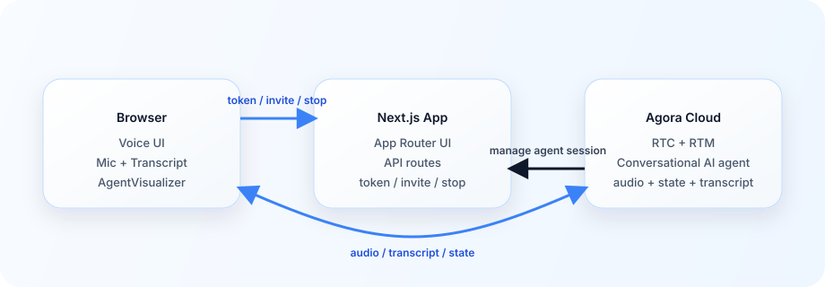

# FieldTech Copilot — Voice-First Industrial Field Service AI Assistant

> **Track:** Voice AI at Work: Beyond the Call Center  
> **Event:** Build with Agora Hackathon (Bengaluru)  
> **Built with:** Agora Conversational AI (RTC + RTM) · Murf AI Falcon TTS · OpenAI Custom LLM SSE · Next.js App Router · TypeScript · Tailwind CSS

Enterprise-grade, voice-first Field Service AI Agent enabling hands-free industrial maintenance workflows: retrieving work order context, interactive voice troubleshooting, checking and reserving spare parts with human confirmation, and generating formal field service reports.

---

## 🛠️ Technology Stack & Architecture

- **Voice & Real-Time Signaling:** Agora Conversational AI Engine (`agora-rtc-react`, `agora-rtc-sdk-ng`, `agora-rtm`, `agora-agent-client-toolkit`, `agora-agent-uikit`)
- **Text-to-Speech (TTS):** **Murf AI Falcon TTS** (`vendor: "murf"`, model `FALCON`, streaming WebSocket @ 24kHz via Agora ConvoAI)
- **Agentic Brain & Tools:** Custom OpenAI-compatible SSE route (`/api/chat/completions`) executing multi-step tool calls with human-in-the-loop confirmation
- **UI Shell:** Split-screen Industrial Operations Console (Next.js 14 App Router, React, Tailwind CSS)
- **Base Starter:** `AgoraIO-Conversational-AI/agent-quickstart-nextjs`

<picture>
  <source media="(prefers-color-scheme: dark)" srcset="./system-architecture-dark.svg">
  
</picture>

---

## 🎯 The 5-Stage Demo Flow

| Stage | Phase | Voice Interaction | Real-Time Agentic Action |
|---|---|---|---|
| **1** | **Before (Initiate)** | *"Pull up my assigned ticket for Bay 4"* | Calls `get_assigned_ticket` → Loads Ticket `TKT-409` (5G Baseband Unit `BBU-9000X`), past maintenance history, and safety lockout notes |
| **2** | **During (Troubleshoot)** | *"Error E-412 and fan rattling, what's the diagnostic procedure?"* | Calls `search_maintenance_manual` → Displays OEM runbook, torque specs (1.8 Nm), and red high-voltage safety warning |
| **3** | **Action & Confirm** | *"Check if replacement fan is in stock and reserve it"* | Calls `check_part_inventory` → Finds 4 at BLR-EAST-HUB → Asks verbal confirmation → Technician confirms → Calls `reserve_spare_part` (`confirmed=true`) + `update_work_order` |
| **4** | **Error Handling** | *"Check stock for legacy PSU-770"* | Returns graceful out-of-stock fallback and suggests `PSU-770-REV2` |
| **5** | **Follow-Up** | *"Generate my field service report for the supervisor"* | Calls `generate_service_report` → Compiles structured report, sets `supervisorNotified=true`, enables 1-click JSON download & print |

---

## 🚀 Quickstart & Setup

### Prerequisites
- [Node.js 20+](https://nodejs.org/)
- [pnpm](https://pnpm.io/)
- [ngrok](https://ngrok.com/) (to provide Agora Cloud with a public HTTPS URL to reach your custom LLM)

### 1. Install Dependencies
```bash
pnpm install
```

### 2. Configure Environment Variables
Copy `env.local.example` to `.env.local`:
```bash
cp env.local.example .env.local
```

Fill in required credentials:
```env
# Agora Credentials
NEXT_PUBLIC_AGORA_APP_ID=your_agora_app_id
NEXT_AGORA_APP_CERTIFICATE=your_agora_app_certificate
NEXT_AGORA_CUSTOMER_ID=your_customer_id
NEXT_AGORA_CUSTOMER_SECRET=your_customer_secret

# Public Tunnel URL (Agora Cloud makes HTTP requests to your Custom LLM here)
APP_PUBLIC_URL=https://your-tunnel.ngrok-free.app

# Murf AI Falcon TTS
MURF_API_KEY=your_murf_api_key
MURF_VOICE_ID=en-US-ken
MURF_MODEL=FALCON
MURF_LOCALE=en-US

# Custom LLM Backend
LLM_API_URL=https://api.openai.com/v1/chat/completions
LLM_API_KEY=your_openai_api_key
LLM_MODEL=gpt-4o-mini
CUSTOM_LLM_AUTH_TOKEN=fieldtech-secret-token
```

### 3. Run Locally

In Terminal 1 (Public Tunnel):
```bash
ngrok http 3000
# Copy HTTPS URL to APP_PUBLIC_URL in .env.local
```

In Terminal 2 (Dev Server):
```bash
pnpm dev
```

Open [http://localhost:3000](http://localhost:3000) and click **Start conversation**.

---

## 🧪 Verification Commands

```bash
pnpm run lint           # ESLint checks
pnpm run typecheck      # TypeScript validation (must be 0 errors)
pnpm run verify:api     # API contract check
pnpm run build          # Production build check
pnpm run verify         # Complete quality gate
```

---

## 📂 Project Structure

```text
fieldtech-copilot/
├── AGENTS.md                              # AI agent technical guide & inviolable rules
├── REQUIREMENTS.md                        # Master product specification
├── docs/
│   ├── BUILD_PLAN.md                      # Milestone sequencing & execution plan
│   ├── IMPLEMENTATION.md                  # Complete production TypeScript implementation
│   └── DEMO_SCRIPT.md                     # Live 5-stage judging demo script
├── app/
│   ├── api/
│   │   ├── generate-agora-token/route.ts  # Combined RTC + RTM token issuer (FROZEN)
│   │   ├── invite-agent/route.ts          # Starts ConvoAI agent with Murf Falcon & Custom LLM
│   │   ├── stop-conversation/route.ts     # Teardown & session stop (FROZEN)
│   │   ├── chat/completions/route.ts      # Custom LLM SSE endpoint running agentic tool loop
│   │   └── field-state/route.ts           # Real-time state polling & demo reset API
│   ├── layout.tsx
│   └── page.tsx
├── lib/
│   ├── agora.ts                           # Shared Agora UID constants (FROZEN)
│   ├── conversation.ts                    # Transcript normalization
│   ├── field-store.ts                     # In-memory enterprise mock database & state manager
│   ├── field-tech-prompt.ts               # Voice-safe system prompt for Murf Falcon TTS
│   └── agent-tools.ts                     # 6 OpenAI-compatible tools & executors
└── components/
    ├── ConversationComponent.tsx          # WebRTC audio, toolkit init, mic lifecycle (FROZEN)
    ├── QuickstartConversationLayout.tsx   # Split-screen workspace container
    └── FieldOperationsConsole.tsx         # Live work order, runbook, inventory, and audit log UI
```

---

## 📄 License

Released under the [MIT License](./LICENSE).
